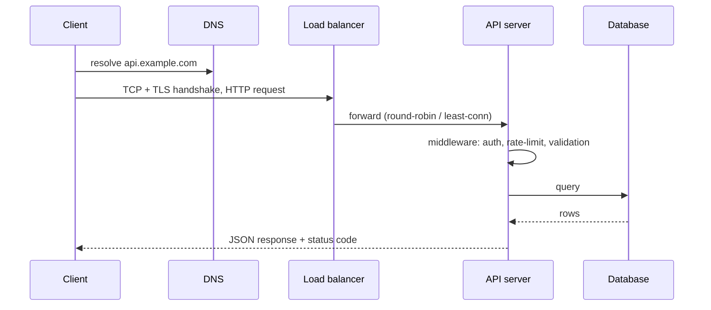

# HTTP & REST Fundamentals

## What is an API?

An **Application Programming Interface** is a contract that lets one piece of software use another without knowing its internals. A **web API** exposes that contract over the network — usually HTTP.

## Anatomy of an HTTP request/response

```http
POST /api/v1/orders?notify=true HTTP/1.1          <- method, path, query, version
Host: shop.example.com
Authorization: Bearer eyJhbGciOi...
Content-Type: application/json
Idempotency-Key: 6f1c-...

{"product_id": 42, "quantity": 2}                  <- body
```

```http
HTTP/1.1 201 Created
Location: /api/v1/orders/9001
Content-Type: application/json
ETag: "a1b2c3"

{"id": 9001, "status": "PENDING"}
```

**HTTP is stateless** — every request carries everything needed to process it (auth, context).

### Request lifecycle



## HTTP methods

| Method | Purpose | Safe | Idempotent | Body |
|---|---|---|---|---|
| GET | Read resource(s) | ✅ | ✅ | no |
| HEAD | GET without body (headers only) | ✅ | ✅ | no |
| OPTIONS | Allowed methods / CORS preflight | ✅ | ✅ | no |
| POST | Create / trigger action | ❌ | ❌ | yes |
| PUT | **Replace** entire resource (or create at known URI) | ❌ | ✅ | yes |
| PATCH | **Partial** update | ❌ | ❌ (can be made so) | yes |
| DELETE | Remove resource | ❌ | ✅ | optional |

- **Safe** = doesn't change server state.
- **Idempotent** = making the same request N times has the same effect as once. (DELETE twice: first 204, second 404 — but the *state* is the same.)

```http
PUT /users/7      {"name": "Lenin", "email": "l@x.com", "role": "lead"}   # full replacement
PATCH /users/7    {"role": "staff"}                                         # only this field
```

## Status codes (know these cold)

| Code | Meaning | When |
|---|---|---|
| **200** OK | Success with body | GET, PUT, PATCH |
| **201** Created | Resource created | POST; include `Location` header |
| **202** Accepted | Queued for async processing | long jobs, return a job URL |
| **204** No Content | Success, no body | DELETE, some PUT |
| **301/308** | Permanent redirect | moved resources |
| **304** Not Modified | Cached copy still valid | conditional GET with ETag |
| **400** Bad Request | Malformed request | invalid JSON |
| **401** Unauthorized | **Not authenticated** (who are you?) | missing/expired token |
| **403** Forbidden | **Authenticated but not allowed** | wrong role |
| **404** Not Found | Resource doesn't exist (or hidden) | |
| **405** Method Not Allowed | | POST on read-only endpoint |
| **409** Conflict | State conflict | duplicate email, version clash |
| **412** Precondition Failed | `If-Match` ETag mismatch | optimistic locking |
| **415** Unsupported Media Type | wrong Content-Type | |
| **422** Unprocessable Entity | Valid JSON, failed validation | FastAPI default |
| **429** Too Many Requests | Rate limited | include `Retry-After` |
| **500** Internal Server Error | Bug | |
| **502** Bad Gateway | Upstream returned invalid response | |
| **503** Service Unavailable | Overloaded / maintenance | |
| **504** Gateway Timeout | Upstream too slow | |

## REST: the six constraints

**RE**presentational **S**tate **T**ransfer (Roy Fielding, 2000):

1. **Client–server** — separation of concerns.
2. **Stateless** — no client session stored on the server between requests.
3. **Cacheable** — responses declare cacheability.
4. **Uniform interface** — resources identified by URIs, manipulated via representations, self-descriptive messages, **HATEOAS** (links to next actions).
5. **Layered system** — client can't tell if it talks to the server or a proxy/CDN.
6. **Code on demand** (optional) — server can send executable code.

**Richardson Maturity Model:** L0 (one endpoint, RPC over HTTP) → L1 (resources) → L2 (HTTP verbs + status codes — most "REST" APIs) → L3 (HATEOAS).

## Resource & URL design

```text
GET    /api/v1/users                 list users
POST   /api/v1/users                 create user
GET    /api/v1/users/{id}            get one
PUT    /api/v1/users/{id}            replace
PATCH  /api/v1/users/{id}            partial update
DELETE /api/v1/users/{id}            delete
GET    /api/v1/users/{id}/orders     sub-resource (relationship)
POST   /api/v1/orders/{id}/cancel    action that isn't CRUD -> verb sub-resource
GET    /api/v1/orders?status=paid&sort=-created_at&limit=20
```

**Rules:** plural nouns, no verbs in paths (except actions), lowercase-kebab, nest max 1–2 levels, filtering/sorting/pagination via query params, consistent JSON (`snake_case` or `camelCase` — pick one).

### Consistent error format (RFC 9457 Problem Details)

```json
{
  "type": "https://api.example.com/errors/insufficient-funds",
  "title": "Insufficient funds",
  "status": 409,
  "detail": "Balance 30.00 is less than 50.00",
  "instance": "/payments/abc",
  "errors": [{"field": "amount", "message": "exceeds balance"}],
  "request_id": "req_8f2a"
}
```

## Idempotency for POST (payments!)

Network retries can create duplicate charges. The client sends an `Idempotency-Key` header; the server stores the key + response and returns the **same** response on retries.

```python
async def create_payment(req, idempotency_key: str):
    cached = await redis.get(f"idem:{idempotency_key}")
    if cached:
        return json.loads(cached)               # replay, no double charge
    # (also lock the key to block concurrent duplicates: SET NX)
    result = await charge_card(req)
    await redis.set(f"idem:{idempotency_key}", json.dumps(result), ex=86400)
    return result
```

## Pagination

| Type | Request | Pros | Cons |
|---|---|---|---|
| **Offset** | `?limit=20&offset=40` | Simple, jump to page N | Slow on big offsets (DB scans skipped rows); duplicates/skips when data changes |
| **Cursor / keyset** | `?limit=20&cursor=eyJpZCI6MTAwfQ` | Fast (uses index), stable under inserts | No random page jump |
| **Page number** | `?page=3&size=20` | User-friendly | Same as offset |

```sql
-- offset: DB reads and discards 100000 rows
SELECT * FROM orders ORDER BY id LIMIT 20 OFFSET 100000;
-- keyset: index seek, O(log n)
SELECT * FROM orders WHERE id > :last_seen_id ORDER BY id LIMIT 20;
```

```json
{ "data": [ ... ], "next_cursor": "eyJpZCI6MTIwfQ", "has_more": true }
```

## Versioning

| Strategy | Example | Notes |
|---|---|---|
| URI path | `/api/v1/users` | Most common, explicit, cache-friendly |
| Header | `Accept: application/vnd.shop.v2+json` | Clean URLs, harder to test |
| Query param | `?version=2` | Simple, less clean |

Rules: never break existing clients — additive changes (new optional fields) are non-breaking; removing/renaming fields or changing types is breaking → new version + deprecation period (`Deprecation`, `Sunset` headers).

## Caching

- `Cache-Control: public, max-age=3600` / `private` / `no-store`.
- **ETag** + `If-None-Match` → `304 Not Modified` (saves bandwidth).
- **ETag** + `If-Match` on PUT → `412` if someone changed it meanwhile (**optimistic concurrency**).
- Layers: browser → CDN → reverse proxy → app cache (Redis) → DB.

## Content negotiation & headers worth knowing

`Accept`, `Content-Type`, `Authorization`, `Cache-Control`, `ETag`, `If-None-Match`, `Location`, `Retry-After`, `X-Request-ID`, `RateLimit-Limit/Remaining/Reset`, `Origin`, `Access-Control-Allow-Origin`.

## REST vs GraphQL vs gRPC vs WebSocket

| | REST | GraphQL | gRPC | WebSocket |
|---|---|---|---|---|
| Transport | HTTP/1.1+ | HTTP (single endpoint) | HTTP/2 | TCP (upgraded HTTP) |
| Payload | JSON | JSON | Protobuf (binary) | any |
| Contract | OpenAPI | Schema (SDL) | `.proto` | none |
| Strength | Simple, cacheable, universal | Client picks fields, no over/under-fetching, one round trip | Fast, typed, streaming, great for internal microservices | Real-time bidirectional |
| Weakness | Over/under-fetching, many round trips | Caching harder, N+1 on resolvers, complexity | Not browser-native, binary debugging | Stateful, scaling connections |
| Use for | Public APIs, CRUD | Complex UIs, mobile | Service-to-service | Chat, live dashboards |

Other: **SSE** (server-sent events — one-way server push, great for LLM token streaming), **long polling**, **SOAP** (XML, legacy enterprise).

## Webhooks

Server-to-server callbacks: "call me when X happens" (e.g. PayPal/Stripe payment events).

- Verify **HMAC signature** of the payload with a shared secret.
- Respond **2xx fast**, process asynchronously (queue).
- Be **idempotent** — webhooks are delivered at-least-once; dedupe on event ID.
- Sender retries with exponential backoff.

```python
import hmac, hashlib
def verify(payload: bytes, signature: str, secret: str) -> bool:
    expected = hmac.new(secret.encode(), payload, hashlib.sha256).hexdigest()
    return hmac.compare_digest(expected, signature)     # constant-time compare
```

## Long-running operations

Return **202 Accepted** + a status URL; client polls (or receives a webhook).

```http
POST /reports        -> 202 Accepted, Location: /jobs/77
GET  /jobs/77        -> {"status": "running", "progress": 40}
GET  /jobs/77        -> {"status": "done", "result_url": "/reports/5"}
```

## API documentation

OpenAPI (Swagger) spec — FastAPI generates it automatically at `/docs` and `/openapi.json`. Contract-first design: write the spec, review it, generate clients/servers.

!!! success "Say this in the interview"
    "I design resources around nouns with standard HTTP verbs and correct status codes, use cursor pagination for large collections, version in the URL, return RFC 9457 problem-details errors, and make every mutating endpoint safe to retry — PUT/DELETE are naturally idempotent, and POST gets an Idempotency-Key, which is essential for payments."
