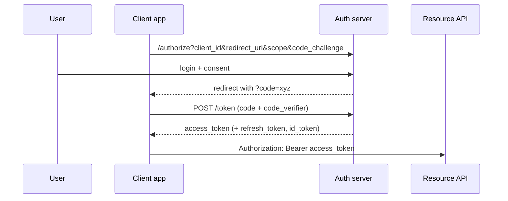

# Auth & Security

## Authentication vs authorization

- **Authentication (AuthN)** — *who are you?* → failure = **401**
- **Authorization (AuthZ)** — *what are you allowed to do?* → failure = **403**

## Session-based vs token-based auth

| | Server session (cookie) | Token (JWT) |
|---|---|---|
| State | Server stores session (DB/Redis) | Stateless; claims inside the token |
| Revocation | Easy — delete session | Hard — needs short expiry + denylist/refresh rotation |
| Scaling | Shared session store needed | Any server can verify signature |
| Best for | Browser apps on same domain | APIs, mobile, microservices |
| CSRF risk | Yes (cookies auto-sent) → CSRF tokens, `SameSite` | No if sent in `Authorization` header |

## JWT (JSON Web Token)

`header.payload.signature` — each part base64url-encoded. **Signed, not encrypted** — anyone can read the payload, nobody can modify it without the key.

```json
// header            // payload (claims)
{"alg": "HS256",     {"sub": "user_42", "role": "admin",
 "typ": "JWT"}        "iat": 1730860000, "exp": 1730860900, "iss": "auth.example.com"}
```

```python
from datetime import datetime, timedelta, timezone
import jwt   # PyJWT

SECRET = settings.jwt_secret
def create_access_token(user_id: str, minutes: int = 15) -> str:
    now = datetime.now(timezone.utc)
    return jwt.encode({"sub": user_id, "iat": now, "exp": now + timedelta(minutes=minutes)},
                      SECRET, algorithm="HS256")

def decode(token: str) -> dict:
    return jwt.decode(token, SECRET, algorithms=["HS256"])  # verifies signature + exp
```

**Best practices**

- Short-lived **access token** (5–15 min) + long-lived **refresh token** (stored httpOnly cookie, rotated on use, revocable in DB).
- Always pin `algorithms=[...]` (prevents `alg: none` / algorithm-confusion attacks).
- **HS256** (shared secret) for one service; **RS256/ES256** (private key signs, public key verifies) when many services verify.
- Never put secrets/PII in the payload. Validate `exp`, `iss`, `aud`.
- Store in memory or httpOnly + Secure + SameSite cookies — not `localStorage` (XSS-readable).

## Password storage

Never encrypt, never plain hash (MD5/SHA). Use a **slow, salted, adaptive** hash: **Argon2id** (preferred) or bcrypt.

```python
from passlib.context import CryptContext
pwd = CryptContext(schemes=["argon2"], deprecated="auto")
hashed = pwd.hash("s3cret!")
pwd.verify("s3cret!", hashed)    # True
```

## OAuth 2.0 & OpenID Connect

**OAuth2 = delegated authorization** ("let this app access my Google Drive"). **OIDC = authentication layer on top** (adds an `id_token` JWT with user identity → "Login with Google").

Roles: Resource Owner (user), Client (your app), Authorization Server (Google/Okta), Resource Server (API).

| Grant | Use |
|---|---|
| **Authorization Code + PKCE** | Web, SPA, mobile — the default |
| **Client Credentials** | Machine-to-machine (service accounts) |
| Refresh Token | Get new access tokens |
| ~~Implicit~~, ~~Password~~ | Deprecated |



**PKCE** prevents stolen authorization codes being exchanged — the client proves it holds the original random `code_verifier`.

## API keys

Simple identification for server-to-server or developer access. Send in a header (`X-API-Key`), **store only a hash**, allow rotation, scope them, rate-limit per key.

## Authorization models

- **RBAC** — role → permissions (`admin`, `editor`).
- **ABAC** — rules on attributes (user.dept == resource.dept AND time in business hours).
- **ReBAC** — relationships (Google Zanzibar style: "user is owner of doc's folder").
- Always enforce **object-level** checks: *does this user own order 42?*

```python
def require_role(*roles):
    async def checker(user: User = Depends(get_current_user)):
        if user.role not in roles:
            raise HTTPException(403, "forbidden")
        return user
    return checker

@app.delete("/users/{uid}", dependencies=[Depends(require_role("admin"))])
async def delete_user(uid: int): ...
```

## OWASP API Security Top 10 (2023)

1. **Broken Object Level Authorization (BOLA/IDOR)** — `GET /orders/43` returns someone else's order → always check ownership.
2. **Broken Authentication** — weak tokens, no brute-force protection.
3. **Broken Object Property Level Authorization** — mass assignment (`{"role": "admin"}` accepted) / over-exposing fields → explicit input & output schemas.
4. **Unrestricted Resource Consumption** — no rate limits, unbounded page sizes, huge uploads.
5. **Broken Function Level Authorization** — normal user can call admin endpoints.
6. **Unrestricted Access to Sensitive Business Flows** — bots buying all stock.
7. **Server-Side Request Forgery (SSRF)** — API fetches user-supplied URL → internal metadata endpoints. Allowlist hosts.
8. **Security Misconfiguration** — debug mode, verbose errors, open CORS.
9. **Improper Inventory Management** — forgotten old API versions.
10. **Unsafe Consumption of APIs** — trusting third-party API responses blindly.

## Common attacks & defences

| Attack | Defence |
|---|---|
| **SQL injection** | Parameterized queries / ORM; never f-strings in SQL |
| **XSS** | Output encoding, CSP header, httpOnly cookies |
| **CSRF** | `SameSite` cookies, CSRF tokens, don't use cookies for API auth |
| **Brute force** | Rate limit, lockout, CAPTCHA, MFA |
| **MITM** | TLS everywhere, HSTS |
| **Replay** | Nonces/timestamps in signed requests, short token expiry |
| **Timing attacks** | `hmac.compare_digest` for secrets |
| **Secrets leak** | Env vars / vault (AWS Secrets Manager, HashiCorp Vault); never in git |

```python
# SQL injection
cursor.execute(f"SELECT * FROM users WHERE email = '{email}'")         # ❌  ' OR 1=1 --
cursor.execute("SELECT * FROM users WHERE email = %s", (email,))       # ✅
```

## CORS

Browsers block JS on `a.com` from reading responses from `api.b.com` unless the server sends `Access-Control-Allow-Origin`. Non-simple requests trigger a **preflight** `OPTIONS`. CORS protects users in browsers — it is **not** an API security mechanism (curl ignores it). Never combine `allow_origins=["*"]` with credentials.

## Rate limiting

| Algorithm | How | Notes |
|---|---|---|
| **Fixed window** | Counter per minute | Simple; burst at window edges |
| **Sliding window log/counter** | Weighted current+previous window | Smoother |
| **Token bucket** | Bucket refills at rate r, capacity b; each request takes a token | Allows controlled bursts — most common |
| **Leaky bucket** | Queue drains at constant rate | Smooths output |

```python
import time
class TokenBucket:
    def __init__(self, rate: float, capacity: int):
        self.rate, self.capacity = rate, capacity
        self.tokens, self.last = capacity, time.monotonic()

    def allow(self) -> bool:
        now = time.monotonic()
        self.tokens = min(self.capacity, self.tokens + (now - self.last) * self.rate)
        self.last = now
        if self.tokens >= 1:
            self.tokens -= 1
            return True
        return False
```

Distributed: keep counters in **Redis** (`INCR` + `EXPIRE`, or a Lua script for atomic token bucket), key by user/API key/IP; return `429` + `Retry-After`.

## Security checklist for any endpoint

- [x] TLS only, HSTS
- [x] Authenticate, then authorize at function **and** object level
- [x] Validate input with schemas (types, ranges, lengths); reject unknown fields
- [x] Explicit response schema — no internal fields
- [x] Rate limit + max page size + request body size limit
- [x] Parameterized queries
- [x] Generic error messages to clients, details in logs (with request ID)
- [x] Audit log for sensitive actions
- [x] Secrets from a vault/env, rotated

!!! success "Say this in the interview"
    "I use OAuth2 Authorization Code with PKCE for user login via an identity provider, short-lived JWT access tokens verified with RS256 public keys across services, rotated refresh tokens, and object-level authorization on every request — BOLA is the number-one API vulnerability. Rate limiting is a Redis-backed token bucket per client."
