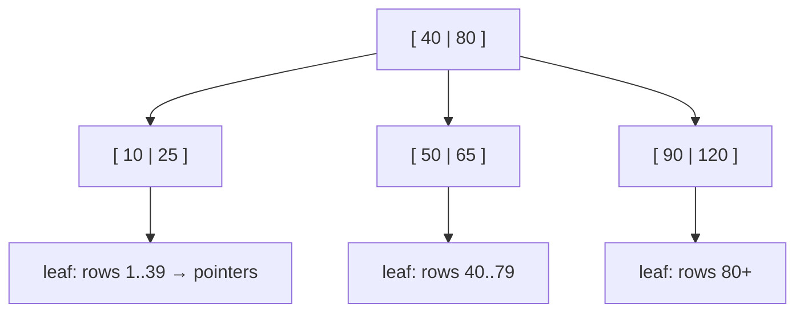
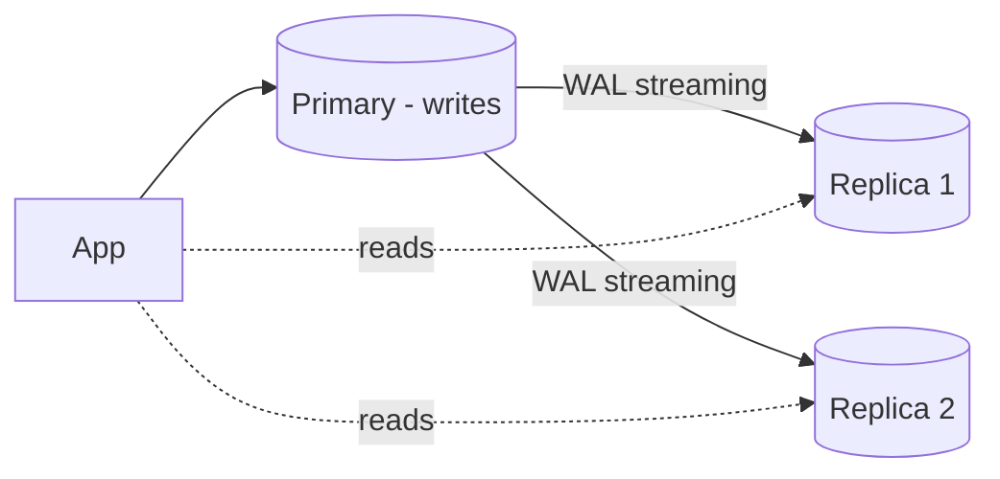

# Indexing, Transactions & Performance

## ACID

| Property | Meaning | Example |
|---|---|---|
| **Atomicity** | All or nothing | Debit and credit both happen or neither |
| **Consistency** | Constraints always hold | Balance never negative (CHECK), FKs valid |
| **Isolation** | Concurrent transactions don't interfere | Two transfers don't corrupt balances |
| **Durability** | Committed data survives crashes | Write-Ahead Log (WAL) flushed to disk |

```sql
BEGIN;
UPDATE accounts SET balance = balance - 100 WHERE id = 1;
UPDATE accounts SET balance = balance + 100 WHERE id = 2;
COMMIT;   -- or ROLLBACK on error
```

## Concurrency anomalies

| Anomaly | What happens |
|---|---|
| **Dirty read** | Read another transaction's *uncommitted* change |
| **Non-repeatable read** | Same row read twice returns different values (someone committed an UPDATE) |
| **Phantom read** | Same query returns new/missing rows (someone INSERTed/DELETEd) |
| **Lost update** | Two read-modify-writes; one overwrites the other |
| **Write skew** | Two transactions read overlapping data and write disjoint rows, violating an invariant (e.g. both doctors go off call) |

## Isolation levels

| Level | Dirty | Non-repeatable | Phantom | Notes |
|---|---|---|---|---|
| Read Uncommitted | possible | possible | possible | Rarely used |
| **Read Committed** | ❌ | possible | possible | **PostgreSQL default** |
| **Repeatable Read** | ❌ | ❌ | possible (❌ in PG) | **MySQL InnoDB default** |
| Serializable | ❌ | ❌ | ❌ | Safest; may abort with serialization errors → retry |

```sql
SET TRANSACTION ISOLATION LEVEL SERIALIZABLE;
```

## Locking & preventing lost updates

```sql
-- Pessimistic: lock the row until commit
BEGIN;
SELECT balance FROM accounts WHERE id = 1 FOR UPDATE;
UPDATE accounts SET balance = balance - 100 WHERE id = 1;
COMMIT;

-- Job queue: workers grab different rows without blocking each other
SELECT * FROM jobs WHERE status = 'queued'
ORDER BY id LIMIT 10 FOR UPDATE SKIP LOCKED;

-- Atomic update (best when possible — no read needed)
UPDATE products SET stock = stock - 1 WHERE id = 7 AND stock > 0;   -- check rows affected

-- Optimistic: version column
UPDATE documents SET body = :body, version = version + 1
WHERE id = :id AND version = :expected_version;   -- 0 rows -> conflict, retry/409
```

| | Optimistic | Pessimistic |
|---|---|---|
| Assumes | Conflicts are rare | Conflicts are common |
| Mechanism | Version/timestamp check on write | `SELECT ... FOR UPDATE` |
| Cost | Retries on conflict | Waiting, deadlock risk |

**Deadlocks** — T1 locks A then B, T2 locks B then A. The DB detects it and aborts one. Prevent by locking rows in a consistent order and keeping transactions short.

## MVCC (Multi-Version Concurrency Control)

PostgreSQL/InnoDB keep **multiple versions** of a row. Readers see a consistent snapshot and **don't block writers; writers don't block readers**. Old versions are cleaned up by `VACUUM` (PG) / purge (InnoDB).

## Indexes

An index is a separate data structure that lets the DB find rows without scanning the whole table — like a book index. **Faster reads, slower writes, more storage.**

### B-tree (default)

Balanced tree, sorted keys, O(log n) lookups. Supports `=`, `<`, `>`, `BETWEEN`, `ORDER BY`, prefix `LIKE 'abc%'`.



| Index type | Use |
|---|---|
| **B-tree** | General purpose, ranges, sorting |
| **Hash** | Equality only |
| **GIN** | JSONB, arrays, full-text search |
| **GiST / SP-GiST** | Geospatial, ranges |
| **BRIN** | Huge append-only tables ordered by time |
| **Full-text** | `tsvector` search |
| **Vector (pgvector HNSW/IVFFlat)** | Embedding similarity search for AI apps |

### Clustered vs non-clustered

- **Clustered**: table rows are physically stored in index order (InnoDB primary key). One per table.
- **Non-clustered / secondary**: separate structure pointing to rows (InnoDB secondary indexes store the PK).

### Composite indexes & the leftmost-prefix rule

```sql
CREATE INDEX idx_orders_cust_status_date ON orders (customer_id, status, created_at);
```

Can serve:
`WHERE customer_id = ?` ✅ · `WHERE customer_id = ? AND status = ?` ✅ · `... AND created_at > ?` ✅ ·
`WHERE status = ?` ❌ (skips leftmost column)

**Column order:** equality columns first, then range/sort columns; most selective first among equalities.

### Covering, partial, expression, unique indexes

```sql
CREATE INDEX idx_cover ON orders (customer_id) INCLUDE (status, created_at);   -- index-only scan
CREATE INDEX idx_pending ON orders (created_at) WHERE status = 'pending';      -- partial
CREATE INDEX idx_lower_email ON employees (LOWER(email));                       -- expression
CREATE UNIQUE INDEX uq_email ON employees (email);
CREATE INDEX CONCURRENTLY idx_x ON big_table (col);                              -- no write lock (PG)
```

### When indexes are NOT used

- Function on column: `WHERE YEAR(created_at) = 2026` → use range `created_at >= '2026-01-01' AND < '2027-01-01'`.
- Leading wildcard: `LIKE '%abc'`.
- Implicit type casts (`varchar_col = 123`).
- Low selectivity (e.g. boolean) — a full scan is cheaper.
- `OR` across different columns (may need separate indexes / UNION).
- Stale statistics → run `ANALYZE`.

## EXPLAIN

```sql
EXPLAIN ANALYZE
SELECT * FROM orders WHERE customer_id = 42 AND status = 'paid';
```

```text
Index Scan using idx_orders_cust_status_date on orders  (cost=0.43..8.45 rows=3 width=40)
  (actual time=0.021..0.025 rows=3 loops=1)
Planning Time: 0.1 ms   Execution Time: 0.05 ms
```

Look for: **Seq Scan** on large tables, big gaps between estimated vs actual rows, **Nested Loop** with large outer sets, sorts spilling to disk, high `loops`.

Join algorithms: **Nested loop** (small outer, indexed inner), **Hash join** (large unsorted equality joins), **Merge join** (both inputs sorted).

## Query optimisation checklist

1. `EXPLAIN ANALYZE` first.
2. Select only needed columns (no `SELECT *`).
3. Right indexes for WHERE/JOIN/ORDER BY; drop unused ones.
4. Avoid N+1 from the ORM; batch.
5. Keyset pagination instead of large OFFSET.
6. `EXISTS` over `IN` for large correlated sets; `UNION ALL` over `UNION` when dupes are impossible.
7. Batch writes (`executemany`, `COPY`), smaller transactions.
8. Connection pooling (PgBouncer, SQLAlchemy pool).
9. Cache hot reads (Redis), materialized views for heavy aggregates.
10. Partition huge tables; archive old data.

## Normalization

Goal: remove redundancy and update anomalies.

| Form | Rule | Violation example |
|---|---|---|
| **1NF** | Atomic values, no repeating groups | `phones = "111,222"` |
| **2NF** | 1NF + no partial dependency on part of a composite key | `order_items(order_id, product_id, product_name)` — name depends only on product_id |
| **3NF** | 2NF + no transitive dependency (non-key → non-key) | `employees(dept_id, dept_name)` — dept_name depends on dept_id |
| **BCNF** | Every determinant is a candidate key | Stricter 3NF |

**Mnemonic:** every non-key attribute depends on *the key (1NF), the whole key (2NF), and nothing but the key (3NF)*.

**Denormalization** deliberately adds redundancy (e.g. store `order_total`, counters, read models) to speed up reads — at the cost of keeping copies consistent. Common in analytics (star schema) and high-read systems.

## OLTP vs OLAP

| | OLTP | OLAP |
|---|---|---|
| Workload | Many small reads/writes | Large scans, aggregations |
| Schema | Normalized | Denormalized (star/snowflake) |
| Storage | Row-oriented (Postgres, MySQL) | Columnar (BigQuery, Snowflake, Redshift, ClickHouse) |

## Scaling databases

- **Vertical scaling** — bigger machine. Simple, finite.
- **Read replicas** — primary handles writes, replicas serve reads. Asynchronous replication → **replication lag** (read-your-writes issue: route a user's reads to primary right after they write).
- **Partitioning** — split a table inside one DB (by range: month; by list: region; by hash).
- **Sharding** — split data across DB servers by a shard key (`user_id % N`, consistent hashing). Pain points: cross-shard joins/transactions, resharding, hot shards.
- **Connection pooling** — reuse connections; Postgres connections are expensive processes.



## Distributed transactions

- **2PC (two-phase commit)** — coordinator asks all to *prepare*, then *commit*. Strong but blocking & slow.
- **Saga pattern** — sequence of local transactions with **compensating actions** on failure (cancel order → refund payment). Orchestrated or choreographed via events.
- **Outbox pattern** — write business row + event row in the *same* local transaction; a relay publishes events to Kafka. Avoids "DB committed but message lost".

!!! success "Say this in the interview"
    "I design indexes from the query patterns — composite indexes with equality columns first, covering indexes for hot reads — and verify with EXPLAIN ANALYZE. For concurrency I prefer atomic conditional updates, use optimistic locking with a version column for user edits, and `FOR UPDATE SKIP LOCKED` for job queues. Read scaling is replicas plus caching; sharding is the last resort."
