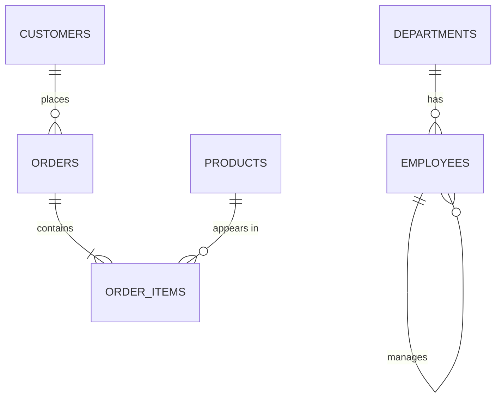
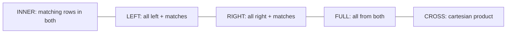

# SQL & Queries

## Sample schema (used everywhere below)



```sql
CREATE TABLE departments (
  id    SERIAL PRIMARY KEY,
  name  VARCHAR(100) NOT NULL UNIQUE
);

CREATE TABLE employees (
  id          SERIAL PRIMARY KEY,
  name        VARCHAR(100) NOT NULL,
  email       VARCHAR(255) UNIQUE NOT NULL,
  salary      NUMERIC(12,2) CHECK (salary > 0),
  dept_id     INT REFERENCES departments(id) ON DELETE SET NULL,
  manager_id  INT REFERENCES employees(id),
  hired_at    DATE NOT NULL DEFAULT CURRENT_DATE
);

CREATE TABLE customers (
  id         SERIAL PRIMARY KEY,
  name       VARCHAR(100) NOT NULL,
  city       VARCHAR(100),
  created_at TIMESTAMPTZ DEFAULT now()
);

CREATE TABLE products (
  id     SERIAL PRIMARY KEY,
  name   VARCHAR(200) NOT NULL,
  price  NUMERIC(10,2) NOT NULL,
  category VARCHAR(50)
);

CREATE TABLE orders (
  id          SERIAL PRIMARY KEY,
  customer_id INT NOT NULL REFERENCES customers(id),
  status      VARCHAR(20) NOT NULL DEFAULT 'pending',
  created_at  TIMESTAMPTZ NOT NULL DEFAULT now()
);

CREATE TABLE order_items (
  order_id   INT REFERENCES orders(id) ON DELETE CASCADE,
  product_id INT REFERENCES products(id),
  quantity   INT NOT NULL CHECK (quantity > 0),
  unit_price NUMERIC(10,2) NOT NULL,
  PRIMARY KEY (order_id, product_id)          -- composite key
);
```

## SQL sub-languages

| | Commands |
|---|---|
| **DDL** (definition) | `CREATE`, `ALTER`, `DROP`, `TRUNCATE` |
| **DML** (manipulation) | `INSERT`, `UPDATE`, `DELETE`, `MERGE` |
| **DQL** (query) | `SELECT` |
| **DCL** (control) | `GRANT`, `REVOKE` |
| **TCL** (transaction) | `BEGIN`, `COMMIT`, `ROLLBACK`, `SAVEPOINT` |

## Constraints

`PRIMARY KEY` (unique + not null, one per table) · `FOREIGN KEY` (referential integrity, with `ON DELETE CASCADE / SET NULL / RESTRICT`) · `UNIQUE` · `NOT NULL` · `CHECK` · `DEFAULT`.

## Basic CRUD

```sql
INSERT INTO departments (name) VALUES ('Engineering'), ('Sales') RETURNING id;

-- Upsert (PostgreSQL)
INSERT INTO products (id, name, price) VALUES (1, 'Laptop', 999)
ON CONFLICT (id) DO UPDATE SET price = EXCLUDED.price;

UPDATE employees SET salary = salary * 1.10 WHERE dept_id = 1;
DELETE FROM orders WHERE status = 'cancelled' AND created_at < now() - INTERVAL '1 year';
```

`DELETE` (row by row, WHERE, logged, fires triggers, rollback-able) vs `TRUNCATE` (removes all rows fast, resets storage) vs `DROP` (removes the table).

## SELECT and logical order of execution

```sql
SELECT   dept_id, COUNT(*) AS headcount       -- 5
FROM     employees                            -- 1
WHERE    salary > 50000                       -- 2  (filters rows)
GROUP BY dept_id                              -- 3
HAVING   COUNT(*) > 3                         -- 4  (filters groups)
ORDER BY headcount DESC                       -- 6
LIMIT    5;                                   -- 7
```

!!! warning "Why can't I use a SELECT alias in WHERE?"
    Because `WHERE` runs **before** `SELECT`. `ORDER BY` runs after, so aliases work there.

```sql
SELECT name, salary FROM employees
WHERE  dept_id IN (1, 2)
  AND  salary BETWEEN 40000 AND 90000
  AND  name LIKE 'L%'            -- ILIKE for case-insensitive (PG)
  AND  manager_id IS NOT NULL    -- never "= NULL"
ORDER  BY salary DESC NULLS LAST
LIMIT  10 OFFSET 0;

SELECT DISTINCT city FROM customers;
SELECT name, COALESCE(city, 'Unknown') AS city FROM customers;
SELECT name,
       CASE WHEN salary >= 100000 THEN 'senior'
            WHEN salary >= 60000  THEN 'mid'
            ELSE 'junior' END AS band
FROM employees;
```

**NULL logic:** `NULL = NULL` is `NULL` (unknown), not true. `COUNT(*)` counts rows; `COUNT(col)` skips NULLs. `NOT IN (subquery with NULL)` returns nothing — prefer `NOT EXISTS`.

## JOINs



```sql
-- INNER: employees with a department
SELECT e.name, d.name AS dept
FROM employees e
JOIN departments d ON d.id = e.dept_id;

-- LEFT: all customers, with their orders if any
SELECT c.name, o.id AS order_id
FROM customers c
LEFT JOIN orders o ON o.customer_id = c.id;

-- Anti-join: customers who NEVER ordered
SELECT c.* FROM customers c
LEFT JOIN orders o ON o.customer_id = c.id
WHERE o.id IS NULL;
-- equivalent, often faster:
SELECT c.* FROM customers c
WHERE NOT EXISTS (SELECT 1 FROM orders o WHERE o.customer_id = c.id);

-- SELF JOIN: employee with their manager
SELECT e.name AS employee, m.name AS manager
FROM employees e
LEFT JOIN employees m ON m.id = e.manager_id;

-- FULL OUTER
SELECT * FROM a FULL OUTER JOIN b ON a.k = b.k;

-- CROSS: every product × every city
SELECT p.name, c.city FROM products p CROSS JOIN (SELECT DISTINCT city FROM customers) c;

-- Multi-table: order totals with customer name
SELECT o.id, c.name, SUM(oi.quantity * oi.unit_price) AS total
FROM orders o
JOIN customers c    ON c.id = o.customer_id
JOIN order_items oi ON oi.order_id = o.id
GROUP BY o.id, c.name;
```

!!! tip "LEFT JOIN gotcha"
    A filter on the right table in `WHERE` turns a LEFT JOIN into an INNER JOIN. Put it in the `ON` clause instead:
    `LEFT JOIN orders o ON o.customer_id = c.id AND o.status = 'paid'`

## Aggregation

```sql
SELECT d.name,
       COUNT(e.id)        AS headcount,
       ROUND(AVG(e.salary), 2) AS avg_salary,
       MAX(e.salary)      AS max_salary,
       SUM(e.salary)      AS payroll
FROM departments d
LEFT JOIN employees e ON e.dept_id = d.id
GROUP BY d.name
HAVING COUNT(e.id) >= 1
ORDER BY payroll DESC;

-- Conditional aggregation (pivot)
SELECT DATE_TRUNC('month', created_at) AS month,
       COUNT(*) FILTER (WHERE status = 'paid')      AS paid,
       COUNT(*) FILTER (WHERE status = 'cancelled') AS cancelled,
       SUM(CASE WHEN status = 'paid' THEN 1 ELSE 0 END) AS paid_portable
FROM orders
GROUP BY 1 ORDER BY 1;
```

## Subqueries

```sql
-- Scalar: employees earning above company average
SELECT name, salary FROM employees
WHERE salary > (SELECT AVG(salary) FROM employees);

-- Correlated: above THEIR department's average (runs per row, logically)
SELECT e.name, e.salary, e.dept_id FROM employees e
WHERE e.salary > (SELECT AVG(salary) FROM employees WHERE dept_id = e.dept_id);

-- IN / EXISTS
SELECT * FROM products
WHERE id IN (SELECT product_id FROM order_items);

-- Derived table
SELECT dept_id, avg_sal FROM (
  SELECT dept_id, AVG(salary) AS avg_sal FROM employees GROUP BY dept_id
) t WHERE avg_sal > 70000;
```

## CTEs (WITH) and recursive CTEs

```sql
WITH customer_totals AS (
  SELECT o.customer_id, SUM(oi.quantity * oi.unit_price) AS lifetime_value
  FROM orders o JOIN order_items oi ON oi.order_id = o.id
  WHERE o.status = 'paid'
  GROUP BY o.customer_id
)
SELECT c.name, ct.lifetime_value
FROM customer_totals ct JOIN customers c ON c.id = ct.customer_id
ORDER BY ct.lifetime_value DESC LIMIT 10;

-- Recursive: full reporting chain under manager 1 (org chart / category tree)
WITH RECURSIVE reports AS (
  SELECT id, name, manager_id, 1 AS depth FROM employees WHERE id = 1
  UNION ALL
  SELECT e.id, e.name, e.manager_id, r.depth + 1
  FROM employees e JOIN reports r ON e.manager_id = r.id
)
SELECT * FROM reports ORDER BY depth;
```

## Window functions

Compute across a set of rows **related to the current row** without collapsing them (unlike GROUP BY).

```sql
SELECT name, dept_id, salary,
  ROW_NUMBER() OVER (PARTITION BY dept_id ORDER BY salary DESC) AS rn,      -- 1,2,3,4
  RANK()       OVER (PARTITION BY dept_id ORDER BY salary DESC) AS rnk,     -- 1,2,2,4
  DENSE_RANK() OVER (PARTITION BY dept_id ORDER BY salary DESC) AS drnk,    -- 1,2,2,3
  AVG(salary)  OVER (PARTITION BY dept_id)                     AS dept_avg,
  salary - AVG(salary) OVER (PARTITION BY dept_id)             AS diff_from_avg,
  SUM(salary)  OVER (ORDER BY hired_at)                         AS running_payroll,
  LAG(salary)  OVER (PARTITION BY dept_id ORDER BY hired_at)    AS prev_hire_salary,
  LEAD(salary) OVER (PARTITION BY dept_id ORDER BY hired_at)    AS next_hire_salary,
  NTILE(4)     OVER (ORDER BY salary)                           AS quartile,
  PERCENT_RANK() OVER (ORDER BY salary)                         AS pct
FROM employees;

-- 7-day moving average of revenue
SELECT day, revenue,
  AVG(revenue) OVER (ORDER BY day ROWS BETWEEN 6 PRECEDING AND CURRENT ROW) AS ma7
FROM daily_revenue;
```

## Set operations

```sql
SELECT city FROM customers UNION     SELECT city FROM stores;   -- dedupes
SELECT city FROM customers UNION ALL SELECT city FROM stores;   -- keeps dupes, faster
SELECT city FROM customers INTERSECT SELECT city FROM stores;
SELECT city FROM customers EXCEPT    SELECT city FROM stores;   -- MINUS in Oracle
```

## Views, materialized views, procedures, triggers

```sql
CREATE VIEW paid_orders AS SELECT * FROM orders WHERE status = 'paid';   -- stored query

CREATE MATERIALIZED VIEW monthly_sales AS                                 -- stored RESULT
SELECT DATE_TRUNC('month', created_at) m, COUNT(*) FROM orders GROUP BY 1;
REFRESH MATERIALIZED VIEW CONCURRENTLY monthly_sales;

CREATE FUNCTION set_updated_at() RETURNS trigger AS $$
BEGIN NEW.updated_at = now(); RETURN NEW; END $$ LANGUAGE plpgsql;
CREATE TRIGGER trg_upd BEFORE UPDATE ON orders
FOR EACH ROW EXECUTE FUNCTION set_updated_at();
```

## 🔥 Top interview queries

=== "Nth highest salary"

    ```sql
    -- 2nd highest (handles ties)
    SELECT DISTINCT salary FROM employees ORDER BY salary DESC LIMIT 1 OFFSET 1;

    -- Nth with window function
    SELECT salary FROM (
      SELECT salary, DENSE_RANK() OVER (ORDER BY salary DESC) AS r FROM employees
    ) t WHERE r = 3 LIMIT 1;

    -- Without LIMIT/window
    SELECT MAX(salary) FROM employees WHERE salary < (SELECT MAX(salary) FROM employees);
    ```

=== "Top N per group"

    ```sql
    -- Top 2 earners in each department
    SELECT * FROM (
      SELECT e.*, DENSE_RANK() OVER (PARTITION BY dept_id ORDER BY salary DESC) r
      FROM employees e
    ) t WHERE r <= 2;
    ```

=== "Duplicates"

    ```sql
    -- Find duplicate emails
    SELECT email, COUNT(*) FROM employees GROUP BY email HAVING COUNT(*) > 1;

    -- Delete duplicates keeping lowest id
    DELETE FROM employees e
    USING employees e2
    WHERE e.email = e2.email AND e.id > e2.id;

    -- Portable version
    DELETE FROM employees WHERE id NOT IN (
      SELECT MIN(id) FROM employees GROUP BY email
    );
    ```

=== "Employees > manager"

    ```sql
    SELECT e.name FROM employees e
    JOIN employees m ON m.id = e.manager_id
    WHERE e.salary > m.salary;
    ```

=== "Running total & MoM growth"

    ```sql
    WITH monthly AS (
      SELECT DATE_TRUNC('month', o.created_at) AS m,
             SUM(oi.quantity * oi.unit_price) AS revenue
      FROM orders o JOIN order_items oi ON oi.order_id = o.id
      GROUP BY 1
    )
    SELECT m, revenue,
           SUM(revenue) OVER (ORDER BY m) AS cumulative,
           ROUND(100.0 * (revenue - LAG(revenue) OVER (ORDER BY m))
                 / NULLIF(LAG(revenue) OVER (ORDER BY m), 0), 2) AS mom_growth_pct
    FROM monthly;
    ```

=== "Consecutive days"

    ```sql
    -- Users who logged in 3+ consecutive days (gaps & islands)
    WITH d AS (
      SELECT DISTINCT user_id, login_date::date AS day FROM logins
    ), g AS (
      SELECT user_id, day,
             day - (ROW_NUMBER() OVER (PARTITION BY user_id ORDER BY day))::int AS grp
      FROM d
    )
    SELECT user_id, MIN(day) AS start_day, COUNT(*) AS streak
    FROM g GROUP BY user_id, grp HAVING COUNT(*) >= 3;
    ```

=== "Products never sold / best seller"

    ```sql
    SELECT p.* FROM products p
    WHERE NOT EXISTS (SELECT 1 FROM order_items oi WHERE oi.product_id = p.id);

    SELECT p.category, p.name, SUM(oi.quantity) AS units
    FROM products p JOIN order_items oi ON oi.product_id = p.id
    GROUP BY p.category, p.name
    ORDER BY units DESC LIMIT 1;
    ```

=== "Department with highest avg"

    ```sql
    SELECT d.name, AVG(e.salary) AS avg_sal
    FROM employees e JOIN departments d ON d.id = e.dept_id
    GROUP BY d.name
    ORDER BY avg_sal DESC
    LIMIT 1;
    ```

## Using SQL safely from Python

```python
import psycopg   # psycopg 3
with psycopg.connect(DSN) as conn:          # transaction committed on exit
    with conn.cursor() as cur:
        cur.execute(
            "SELECT id, name FROM employees WHERE dept_id = %s AND salary > %s",
            (dept_id, min_salary),           # parameters -> no SQL injection
        )
        rows = cur.fetchall()
        cur.executemany("INSERT INTO departments (name) VALUES (%s)", [("HR",), ("Ops",)])
```

!!! success "Say this in the interview"
    "I think in sets, not loops: joins to combine, GROUP BY to aggregate, window functions when I need per-row context like rankings or running totals, and CTEs to keep complex queries readable. I always check the plan with EXPLAIN ANALYZE before declaring a query done."
