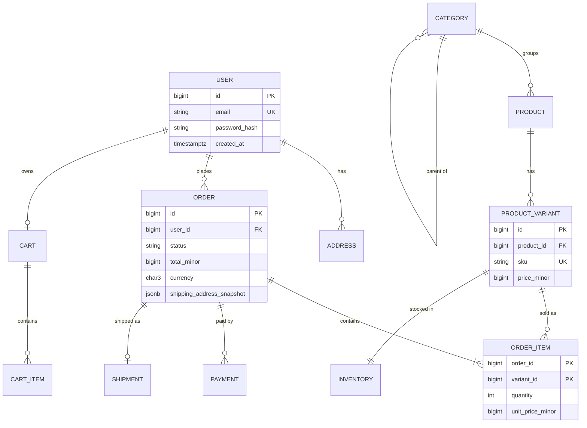
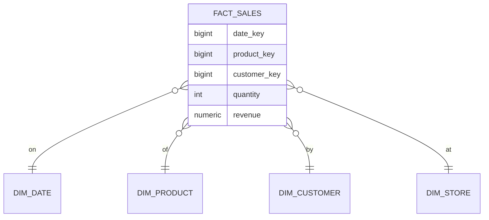

# Data Modeling

Data modeling = deciding **what data you store, how it's structured, and how pieces relate** — driven by the business rules and the **access patterns** (the queries you must serve).

## Three levels

| Level | Audience | Contains |
|---|---|---|
| **Conceptual** | Business | Entities and relationships ("Customer places Order") |
| **Logical** | Engineers | Attributes, keys, cardinality, normalization — DB-agnostic |
| **Physical** | DBA / implementation | Tables, data types, indexes, partitions, constraints for a specific DB |

## Process (use this in interviews)

1. **Clarify requirements** — entities, rules, volumes, read/write ratio.
2. **List access patterns** — "get a user's last 20 orders", "monthly revenue by category".
3. **Identify entities & attributes** (nouns) and **relationships** (verbs).
4. **Define keys & cardinality**.
5. **Normalize to 3NF**, then **denormalize deliberately** for hot read paths.
6. **Add indexes** for access patterns, constraints for invariants.
7. **Plan for change** — soft deletes, audit history, migrations, multi-tenancy.

## Cardinality

| Relationship | Example | Implementation |
|---|---|---|
| **One-to-one** | User ↔ Profile | FK with UNIQUE, or same table |
| **One-to-many** | Customer → Orders | FK on the "many" side (`orders.customer_id`) |
| **Many-to-many** | Students ↔ Courses | Junction table `enrollments(student_id, course_id, enrolled_at, grade)` |
| **Self-referencing** | Employee → Manager, Category → Parent | FK to same table |
| **Polymorphic** | Comment on Post *or* Photo | Separate FKs with CHECK, or one table per type (avoid untyped `commentable_type/id`) |

## Worked example 1: E-commerce



**Key decisions to explain:**

- `order_items.unit_price` is **copied** at purchase time — product prices change; orders are historical facts.
- Shipping address **snapshot** on the order for the same reason.
- Money as integer minor units + currency.
- `status` drives a state machine (pending → paid → shipped → delivered / cancelled / refunded).
- `inventory` separate from product (hot, frequently updated row; atomic `UPDATE ... SET qty = qty - n WHERE qty >= n`).
- Category tree via `parent_id` (adjacency list) + recursive CTE; alternatives: materialized path (`/1/4/9/`), nested sets, closure table.

## Worked example 2: Social media feed

```sql
CREATE TABLE users   (id BIGINT PRIMARY KEY, handle TEXT UNIQUE, ...);
CREATE TABLE follows (follower_id BIGINT, followee_id BIGINT, created_at TIMESTAMPTZ,
                      PRIMARY KEY (follower_id, followee_id));
CREATE INDEX ON follows (followee_id);                      -- "who follows me"
CREATE TABLE posts   (id BIGINT PRIMARY KEY, author_id BIGINT, body TEXT,
                      created_at TIMESTAMPTZ, like_count INT DEFAULT 0);   -- denormalized counter
CREATE INDEX ON posts (author_id, created_at DESC);
CREATE TABLE likes   (user_id BIGINT, post_id BIGINT, PRIMARY KEY (user_id, post_id));
```

Feed generation: **fan-out on write** (push post IDs into each follower's feed cache — fast reads, expensive for celebrities) vs **fan-out on read** (query followees' posts at read time) → hybrid for celebrity accounts.

## Worked example 3: Multi-tenant SaaS

| Strategy | Isolation | Cost | Notes |
|---|---|---|---|
| Shared tables + `tenant_id` column | Low | Cheapest | Every query filtered by tenant; enforce with Row-Level Security |
| Schema per tenant | Medium | Medium | Migrations × N schemas |
| Database per tenant | High | Highest | Best for enterprise/regulated customers |

```sql
ALTER TABLE projects ENABLE ROW LEVEL SECURITY;
CREATE POLICY tenant_isolation ON projects
  USING (tenant_id = current_setting('app.tenant_id')::bigint);
```

Composite indexes start with `tenant_id`.

## Common modeling patterns

```sql
-- Audit columns on every table
created_at TIMESTAMPTZ NOT NULL DEFAULT now(),
updated_at TIMESTAMPTZ NOT NULL DEFAULT now(),
created_by BIGINT,

-- Soft delete
deleted_at TIMESTAMPTZ NULL;
CREATE UNIQUE INDEX uq_active_email ON users (email) WHERE deleted_at IS NULL;

-- History / temporal table (Slowly Changing Dimension type 2)
CREATE TABLE price_history (product_id BIGINT, price_minor BIGINT,
                            valid_from TIMESTAMPTZ, valid_to TIMESTAMPTZ);

-- Flexible attributes: JSONB (+ GIN index) instead of EAV tables
ALTER TABLE products ADD COLUMN attributes JSONB;
CREATE INDEX ON products USING GIN (attributes);
SELECT * FROM products WHERE attributes @> '{"color": "black"}';

-- Enumerations: lookup table or CHECK constraint
status TEXT NOT NULL CHECK (status IN ('pending','paid','shipped','cancelled'));

-- Double-entry ledger (payments/fintech): never update balances blindly
CREATE TABLE ledger_entries (id BIGSERIAL, txn_id UUID, account_id BIGINT,
                             amount_minor BIGINT,       -- +credit / -debit
                             created_at TIMESTAMPTZ);   -- SUM(amount) per txn = 0
```

## Domain modeling (DDD essentials)

| Concept | Meaning | Example |
|---|---|---|
| **Entity** | Has identity that persists across changes | `Order(id=42)` |
| **Value object** | Defined by its values, immutable | `Money(100, "INR")`, `Address` |
| **Aggregate** | Cluster of objects changed together via one **root**; a consistency boundary | `Order` root + `OrderLines` |
| **Repository** | Loads/saves whole aggregates | `OrderRepository` |
| **Domain event** | Something that happened | `OrderPaid` |
| **Bounded context** | A model valid within one part of the business | "Customer" in Billing vs Support |

```python
from dataclasses import dataclass, field
from decimal import Decimal

@dataclass(frozen=True)
class Money:                                      # value object
    amount: Decimal
    currency: str
    def __add__(self, other: "Money") -> "Money":
        assert self.currency == other.currency
        return Money(self.amount + other.amount, self.currency)

@dataclass
class OrderLine:
    sku: str
    qty: int
    price: Money

@dataclass
class Order:                                      # aggregate root
    id: int
    lines: list[OrderLine] = field(default_factory=list)
    status: str = "pending"

    def add_line(self, sku: str, qty: int, price: Money) -> None:
        if self.status != "pending":
            raise ValueError("order is locked")    # invariant enforced by the root
        if qty <= 0:
            raise ValueError("qty must be positive")
        self.lines.append(OrderLine(sku, qty, price))

    @property
    def total(self) -> Money:
        total = Money(Decimal(0), "INR")
        for line in self.lines:
            total = total + Money(line.price.amount * line.qty, line.price.currency)
        return total
```

## NoSQL modeling (access-pattern first)

Relational: model the data, then write queries. NoSQL: **model the queries**, then shape the data.

```json
// MongoDB: blog post with embedded bounded comments preview + referenced author
{
  "_id": "post_1",
  "author_id": "user_7",
  "title": "Async Python",
  "tags": ["python", "asyncio"],
  "comment_count": 132,
  "recent_comments": [{"user": "asha", "text": "Great!"}]
}
```

**DynamoDB single-table design:** partition key + sort key encode access patterns.

| PK | SK | Data |
|---|---|---|
| `USER#7` | `PROFILE` | name, email |
| `USER#7` | `ORDER#2026-11-01#42` | total, status |
| `ORDER#42` | `ITEM#LAP-1` | qty, price |

Query "user 7's orders in November" = `PK = USER#7 AND begins_with(SK, "ORDER#2026-11")`.

**Cassandra:** one table per query; partition key decides distribution, clustering columns decide sort order: `PRIMARY KEY ((user_id, month), created_at)`.

## Analytical modeling: star schema



**Fact** tables hold measurable events (narrow, huge); **dimension** tables hold descriptive context (wide, small). Snowflake schema normalizes dimensions further.

## Data model in Python code (Pydantic vs ORM vs domain)

| Layer | Tool | Purpose |
|---|---|---|
| API boundary | Pydantic models | Validation, serialization, OpenAPI |
| Domain | dataclasses / plain classes | Business rules & invariants |
| Persistence | SQLAlchemy / Django models | Table mapping |

Keeping them separate avoids leaking DB columns into the API and lets each evolve independently (small projects can merge them, e.g. SQLModel).

!!! success "Say this in the interview"
    "I start from the access patterns and business invariants, model entities and cardinalities, normalize to 3NF, then denormalize only for proven hot reads — like snapshotting prices on order lines or keeping counters. I store money as integer minor units, timestamps in UTC, add audit columns, and for multi-tenant systems a tenant_id leading every index with row-level security."
