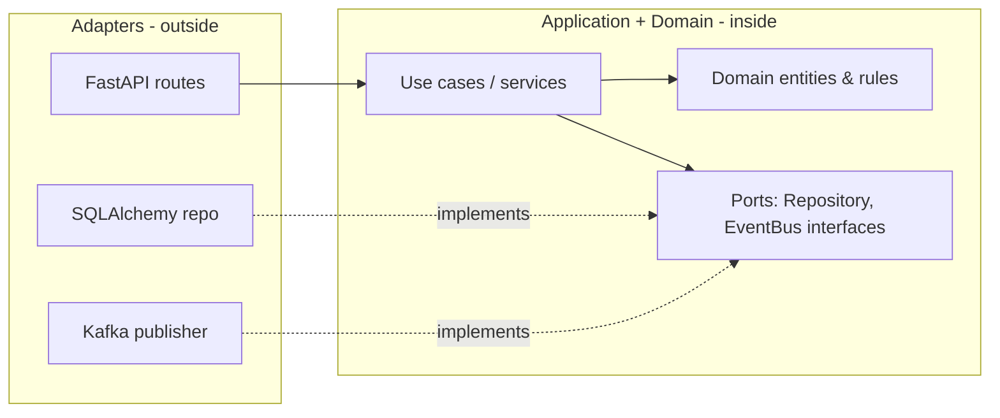

# SOLID & Design Principles

## S — Single Responsibility Principle

*A class should have one reason to change.*

```python
# ❌ One class: business logic + persistence + notification
class OrderService:
    def place(self, order):
        if order.quantity <= 0: raise ValueError("bad order")   # validation
        db.execute("INSERT ...")
        smtp.send(order.email, "Thanks!")

# ✅ Separate responsibilities, composed together
class OrderValidator:
    def validate(self, order): ...

class OrderRepository:
    def save(self, order): ...

class Notifier:
    def order_placed(self, order): ...

class OrderService:
    def __init__(self, validator, repo, notifier):
        self.validator, self.repo, self.notifier = validator, repo, notifier
    def place(self, order):
        self.validator.validate(order)
        self.repo.save(order)
        self.notifier.order_placed(order)
```

## O — Open/Closed Principle

*Open for extension, closed for modification.* Add behaviour by adding code, not editing tested code.

```python
# ❌ Every new method means editing this function
def pay(method, amount):
    if method == "card": ...
    elif method == "upi": ...
    elif method == "paypal": ...

# ✅ New payment types plug in
from abc import ABC, abstractmethod
class PaymentMethod(ABC):
    @abstractmethod
    def pay(self, amount: int) -> str: ...

class Card(PaymentMethod):
    def pay(self, amount): return f"card {amount}"
class Upi(PaymentMethod):
    def pay(self, amount): return f"upi {amount}"

def checkout(method: PaymentMethod, amount: int):
    return method.pay(amount)
```

## L — Liskov Substitution Principle

*Subtypes must be usable wherever the base type is expected, without surprises.*

```python
# ❌ Classic violation: Square changes Rectangle's behaviour contract
class Rectangle:
    def set_width(self, w): self.w = w
    def set_height(self, h): self.h = h
class Square(Rectangle):
    def set_width(self, w): self.w = self.h = w      # surprise!

# ❌ Also a violation: subclass raises where parent didn't
class Bird:
    def fly(self): ...
class Penguin(Bird):
    def fly(self): raise NotImplementedError

# ✅ Model capabilities separately
class Bird: ...
class FlyingBird(Bird):
    def fly(self): ...
class Penguin(Bird): ...
```

Rules: don't strengthen preconditions, don't weaken postconditions, don't throw new exceptions.

## I — Interface Segregation Principle

*Clients shouldn't depend on methods they don't use.* Prefer small, focused interfaces.

```python
from typing import Protocol

# ❌ Fat interface
class Machine(Protocol):
    def print(self, doc): ...
    def scan(self, doc): ...
    def fax(self, doc): ...

# ✅ Small roles
class Printer(Protocol):
    def print(self, doc): ...
class Scanner(Protocol):
    def scan(self, doc): ...

class SimplePrinter:              # only implements what it can
    def print(self, doc): ...
```

## D — Dependency Inversion Principle

*Depend on abstractions, not concretions.* High-level policy shouldn't import low-level details.

```python
# ❌ Hard-wired dependency: untestable without a real Postgres
class ReportService:
    def __init__(self):
        self.db = PostgresDatabase("prod-dsn")

# ✅ Inject an abstraction
class Database(Protocol):
    def query(self, sql: str) -> list[dict]: ...

class ReportService:
    def __init__(self, db: Database):
        self.db = db

ReportService(PostgresDatabase(dsn))   # production
ReportService(FakeDatabase())          # tests
```

**Dependency Injection** is the technique (pass dependencies in); **DIP** is the principle. FastAPI's `Depends` is a DI container.

## Other principles

| Principle | Meaning |
|---|---|
| **DRY** | Don't Repeat Yourself — one source of truth for knowledge (not just code). Avoid premature abstraction ("rule of three"). |
| **KISS** | Keep It Simple — simplest solution that works. |
| **YAGNI** | You Aren't Gonna Need It — don't build for hypothetical requirements. |
| **Composition over inheritance** | Combine small objects instead of deep hierarchies. |
| **Law of Demeter** | Talk only to immediate friends: avoid `order.customer.address.city.name`. |
| **Separation of concerns** | Layers: API / service / domain / data. |
| **Fail fast** | Validate early, raise clear errors. |
| **Principle of least astonishment** | Code should behave as readers expect. |
| **Tell, don't ask** | Ask objects to do things rather than pulling their data and deciding for them. |

## Coupling & cohesion

- **High cohesion** — a module's parts belong together (one purpose).
- **Low coupling** — modules know little about each other; changes don't ripple.

## Layered / Clean / Hexagonal architecture



**Dependencies point inward.** The domain knows nothing about FastAPI or SQLAlchemy; adapters implement ports (interfaces). Benefits: testable core, swappable infrastructure.

!!! success "Say this in the interview"
    "SOLID for me boils down to: small focused units, extension via new implementations of an interface, and dependencies injected as abstractions. That's what makes code testable — my services take a repository protocol, so tests pass an in-memory fake. I balance it with YAGNI: I introduce an abstraction when the second implementation appears."
