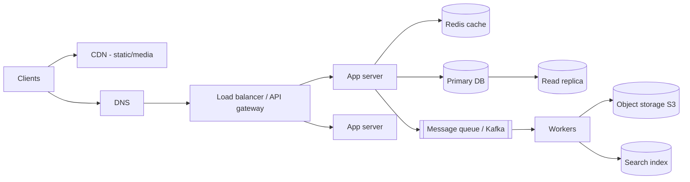
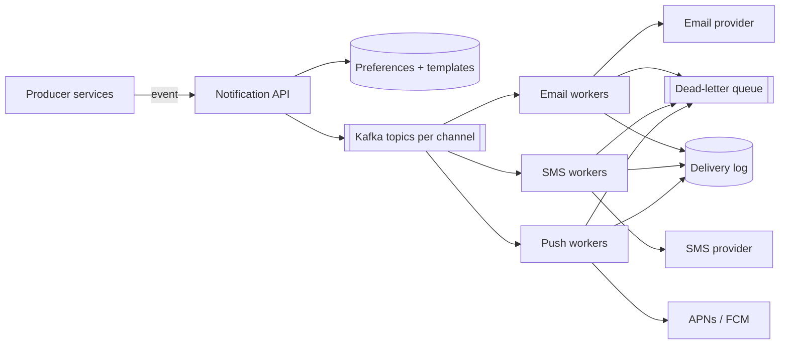

# System Design

## The interview framework (≈45 min)

| Step | Time | What you do |
|---|---|---|
| 1. **Requirements** | 5 min | Functional (features) + non-functional (scale, latency, availability, consistency). Ask questions! |
| 2. **Estimates** | 3 min | Users, QPS, storage, bandwidth (back-of-envelope) |
| 3. **API** | 5 min | Key endpoints & payloads |
| 4. **Data model** | 5 min | Entities, storage choice |
| 5. **High-level design** | 10 min | Boxes & arrows: clients, LB, services, DB, cache, queue |
| 6. **Deep dive** | 12 min | Bottlenecks, scaling, failure modes, trade-offs |
| 7. **Wrap-up** | 3 min | Monitoring, security, what you'd do next |

## Back-of-envelope numbers

| | |
|---|---|
| 1 day | ≈ 86,400 s ≈ **10⁵ s** |
| 1M requests/day | ≈ **12 QPS** (peak ×2–5) |
| 100M DAU × 10 req | ≈ 12k QPS |
| L1 cache / RAM / SSD / network same DC / cross-continent | ~1 ns / 100 ns / 100 µs / 0.5 ms / 150 ms |
| One Postgres node | ~ thousands–10k simple QPS |
| One Redis node | ~ 100k ops/s |
| Char = 1 byte, int64 = 8 B, UUID = 16 B, tweet ≈ 300 B, image ≈ 200 KB |

**Availability:** 99.9% = 8.8 h/year downtime · 99.99% = 52 min/year · 99.999% = 5 min/year.

## Building blocks



| Component | Purpose / key trade-offs |
|---|---|
| **Load balancer** | L4 (TCP) vs L7 (HTTP routing); algorithms: round-robin, least connections, consistent hashing; health checks |
| **API gateway** | Auth, rate limiting, routing, TLS termination |
| **Stateless app servers** | Horizontal scaling; sessions in Redis/JWT |
| **Cache** | Redis/Memcached; cache-aside; CDN for static |
| **Database** | SQL vs NoSQL; replicas; sharding |
| **Message queue** | Decouple, buffer spikes, async processing. RabbitMQ/SQS (task queue) vs **Kafka** (durable log, replay, high throughput, partitions & consumer groups) |
| **Object storage** | Files/media (S3) + pre-signed URLs |
| **Search** | Elasticsearch for full text |
| **Observability** | Logs, metrics (Prometheus), traces (OpenTelemetry), alerts |

## Scalability concepts

- **Vertical vs horizontal** scaling.
- **Stateless services** behind a load balancer; state lives in DB/cache.
- **Consistent hashing** — distribute keys over nodes so adding/removing a node moves only ~1/N keys (virtual nodes for balance). Used in caches, Cassandra, DynamoDB.
- **Async processing** — accept, enqueue, return 202.
- **Back-pressure** — bounded queues, rate limits, load shedding.
- **Delivery semantics** — at-most-once, at-least-once (+ idempotent consumers = effectively once), exactly-once (hard; Kafka transactions).

## Reliability

- Redundancy: no single point of failure, multi-AZ.
- Timeouts + retries (exponential backoff + jitter) + **circuit breakers** + bulkheads.
- Graceful degradation (serve cached/stale, disable non-critical features).
- Health checks, auto-scaling, blue/green & canary deploys, feature flags.
- Idempotency everywhere retries happen.
- Disaster recovery: backups, RPO (data loss tolerance) & RTO (recovery time).

## Microservices vs monolith

| | Monolith (modular) | Microservices |
|---|---|---|
| Deploy | One unit | Independent per service |
| Complexity | In code | In infrastructure & network |
| Data | One DB, easy transactions | DB per service, sagas, eventual consistency |
| Team fit | Small/medium teams | Many autonomous teams |
| Start with | ✅ usually | when scale/org demands it |

Communication: sync (REST/gRPC) vs async (events). Service discovery, service mesh, distributed tracing.

## Worked design 1: URL shortener

**Requirements:** shorten URL, redirect fast, custom alias, expiry, click analytics. 100M new URLs/month, read:write 100:1.

**Estimates:** writes ≈ 40/s, reads ≈ 4k/s (peak 20k). 5 years ≈ 6B URLs × 500 B ≈ 3 TB.

**API:** `POST /links` → `{code}`, `GET /{code}` → 302.

**Code generation:** 7 base62 chars = 62⁷ ≈ 3.5 trillion. Options: base62(counter from a distributed ID generator / pre-allocated ranges per server) — no collisions; or random + uniqueness check; avoid hashing the URL (collisions, same URL → same code).

```python
ALPHABET = "0123456789abcdefghijklmnopqrstuvwxyzABCDEFGHIJKLMNOPQRSTUVWXYZ"
def base62(n: int) -> str:
    s = []
    while n:
        n, r = divmod(n, 62)
        s.append(ALPHABET[r])
    return "".join(reversed(s)) or "0"
```

**Design:** LB → stateless API → Redis cache (code → URL, very hot) → KV store/Postgres (sharded by code). Clicks published to Kafka → analytics workers → OLAP store. 302 keeps analytics; 301 lets browsers cache.

## Worked design 2: Notification service

**Requirements:** send email/SMS/push triggered by other services; templates; user preferences; retries; 10M notifications/day; no duplicates.



Deep-dive points: idempotency key per notification (dedupe on retries), per-provider rate limits & circuit breakers with fallback provider, priority topics (OTP vs marketing), DLQ for poison messages, user quiet hours, tracking delivery/opens via provider webhooks.

## Other classic prompts to practise

Rate limiter · Chat app (WebSockets, presence, message ordering) · News feed · Payment system (idempotency, ledger, reconciliation) · File storage (chunking, dedupe) · Ride sharing (geo-index, matching) · Web crawler · Distributed cache · Search autocomplete (trie, top-k) · **RAG/LLM service** (ingestion pipeline, embeddings, vector DB, retrieval, caching, streaming responses, evaluation, cost/latency controls).

!!! success "Say this in the interview"
    "I always start by pinning down requirements and scale, because they decide everything else. Then I keep services stateless, put a cache in front of the database, push slow or failure-prone work onto a durable queue with idempotent consumers, and design for failure with timeouts, retries with jitter and circuit breakers. I'll call out the trade-off I'm making at each step — usually consistency vs availability or latency vs cost."
