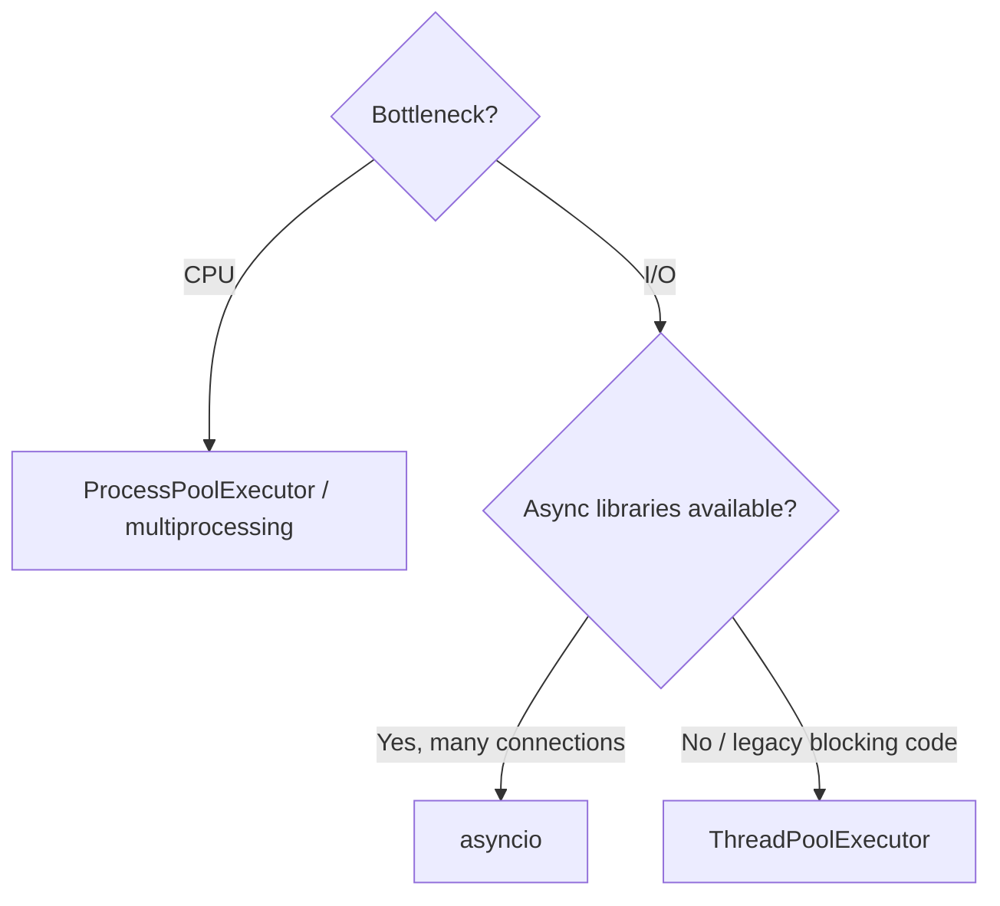

# Concurrency & Async

## Concurrency vs parallelism

- **Concurrency** – dealing with many tasks at once (interleaving). One cook juggling dishes.
- **Parallelism** – doing many tasks at the same instant (multiple cores). Many cooks.

## Choosing the right tool

| Workload | Tool | Why |
|---|---|---|
| I/O-bound, few hundred tasks, blocking libraries | `threading` / `ThreadPoolExecutor` | GIL released on I/O |
| I/O-bound, thousands of connections | `asyncio` | Single thread, cheap coroutines, no thread overhead |
| CPU-bound | `multiprocessing` / `ProcessPoolExecutor` | Separate processes, separate GILs |
| Distributed / background jobs | Celery, RQ, Dramatiq, Kafka consumers | Durable, retryable, scalable |



## Threading

```python
import threading, time
from concurrent.futures import ThreadPoolExecutor, as_completed

def fetch(url):
    time.sleep(1)                # simulate network I/O
    return f"{url}: 200"

urls = [f"https://api/{i}" for i in range(10)]
with ThreadPoolExecutor(max_workers=10) as pool:
    futures = {pool.submit(fetch, u): u for u in urls}
    for fut in as_completed(futures):
        print(fut.result())      # ~1s total instead of 10s
```

### Synchronization primitives

```python
lock = threading.Lock()
balance = 0
def deposit(n):
    global balance
    with lock:                    # critical section
        balance += n

rlock = threading.RLock()          # re-entrant: same thread can acquire twice
sem = threading.Semaphore(5)       # at most 5 concurrent holders (e.g. DB connections)
event = threading.Event()          # one thread signals others: event.set()/event.wait()
cond = threading.Condition()       # wait until a condition becomes true
```

### Producer–consumer with `queue.Queue` (thread-safe)

```python
import queue, threading
q: queue.Queue = queue.Queue(maxsize=100)

def producer():
    for i in range(5):
        q.put(i)
    q.put(None)               # sentinel / poison pill

def consumer():
    while (item := q.get()) is not None:
        print("processing", item)
        q.task_done()

threading.Thread(target=producer).start()
threading.Thread(target=consumer).start()
```

### Classic problems

- **Race condition** – result depends on timing → protect shared state with locks or avoid sharing (queues, immutability).
- **Deadlock** – two threads each hold a lock the other needs → always acquire locks in a **global order**, use timeouts.
- **Starvation / livelock** – a thread never progresses.
- `daemon=True` threads are killed when the main thread exits.

## Multiprocessing

```python
from concurrent.futures import ProcessPoolExecutor
import math

def is_prime(n):
    if n < 2: return False
    return all(n % i for i in range(2, int(math.isqrt(n)) + 1))

if __name__ == "__main__":            # required on Windows/macOS (spawn)
    nums = range(10_000_000, 10_000_100)
    with ProcessPoolExecutor() as pool:
        primes = [n for n, ok in zip(nums, pool.map(is_prime, nums, chunksize=10)) if ok]
```

- Processes don't share memory: data is **pickled** across → overhead. Pass small inputs, big chunks.
- Sharing: `multiprocessing.Queue`, `Pipe`, `Value/Array`, `shared_memory`, `Manager`.
- Start methods: `fork` (Linux default historically), `spawn` (macOS/Windows), `forkserver`.

## asyncio

**Cooperative multitasking on a single thread.** Coroutines yield control at every `await`; the **event loop** runs whichever task is ready.

```python
import asyncio, time

async def fetch(name: str, delay: float) -> str:
    await asyncio.sleep(delay)        # non-blocking wait
    return f"{name} done"

async def main():
    start = time.perf_counter()
    results = await asyncio.gather(
        fetch("users", 1), fetch("orders", 1), fetch("payments", 1)
    )
    print(results, f"{time.perf_counter() - start:.1f}s")   # ~1.0s

asyncio.run(main())
```

### Key concepts

| Term | Meaning |
|---|---|
| `async def` | defines a **coroutine function**; calling it returns a coroutine object (doesn't run yet) |
| `await` | suspend until the awaitable finishes; only inside `async def` |
| Task | a coroutine scheduled on the loop: `asyncio.create_task(coro)` |
| `gather` | run awaitables concurrently, collect results |
| `TaskGroup` (3.11+) | structured concurrency; cancels siblings on failure |
| `wait_for` / `timeout` | timeouts |
| `Semaphore` | limit concurrency |
| `Queue` | async producer-consumer |

```python
async def bounded_fetch_all(urls, limit=10):
    sem = asyncio.Semaphore(limit)
    async def one(url):
        async with sem:
            async with asyncio.timeout(5):          # 3.11+
                await asyncio.sleep(0.1)            # e.g. httpx.AsyncClient().get(url)
                return url
    async with asyncio.TaskGroup() as tg:
        tasks = [tg.create_task(one(u)) for u in urls]
    return [t.result() for t in tasks]
```

### The #1 asyncio mistake: blocking the event loop

```python
async def bad():
    time.sleep(2)               # blocks EVERY coroutine for 2s
    requests.get(url)           # blocking library!

async def good():
    await asyncio.sleep(2)
    result = await asyncio.to_thread(blocking_function, arg)   # offload
```

Use async-native libraries: `httpx`/`aiohttp`, `asyncpg`, SQLAlchemy async, `aioredis`/`redis.asyncio`.

### Async generators & context managers

```python
async def paginate(client):
    page = 1
    while True:
        data = await client.get(page)
        if not data: break
        for item in data:
            yield item
        page += 1

async for item in paginate(client): ...
```

## threading vs asyncio — interview comparison

| | Threads | asyncio |
|---|---|---|
| Scheduling | Pre-emptive (OS) | Cooperative (`await`) |
| Switch points | Anywhere → need locks | Only at `await` → fewer races |
| Scale | Hundreds (≈8MB stack each) | Tens of thousands of tasks |
| Library support | Any blocking library | Needs async libraries |
| Debugging | Harder (non-deterministic) | Easier, but blocking calls are silent killers |

!!! success "Say this in the interview"
    "I pick based on the bottleneck. For CPU-bound work I use processes because of the GIL. For I/O-bound work with many concurrent connections — like a FastAPI service calling other APIs — asyncio gives the best throughput, as long as nothing blocks the event loop; blocking calls go through `asyncio.to_thread`. For durable background work I use a task queue like Celery rather than in-process concurrency."
