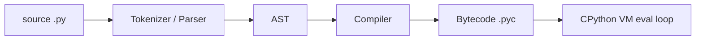

# Internals & Memory

## How CPython runs your code



```python
import dis
def add(a, b): return a + b
dis.dis(add)
#  LOAD_FAST a / LOAD_FAST b / BINARY_OP + / RETURN_VALUE
```

- `.pyc` files are cached in `__pycache__/` and reused if the source is unchanged.
- Python 3.11+ added a **specialising adaptive interpreter** (big speedups); 3.13 added an experimental JIT and an optional **free-threaded (no-GIL)** build.

## The object model

Every object is a C struct (`PyObject`) with a **reference count** and a **type pointer**.

```python
import sys
x = []
sys.getrefcount(x)    # 2 (x + the temporary argument)
sys.getsizeof([])     # 56 bytes (list header, not contents)
id(x)                 # memory address in CPython
```

## Memory management

1. **Reference counting** (primary) — object freed immediately when count hits 0. Deterministic.
2. **Generational cyclic garbage collector** — finds reference cycles refcounting can't free. Three generations (0, 1, 2); young objects scanned most often.
3. **pymalloc** — small-object allocator (≤512 bytes) using arenas/pools to reduce `malloc` overhead.

```python
import gc
class Node:
    def __init__(self): self.ref = None
a, b = Node(), Node()
a.ref, b.ref = b, a       # cycle
del a, b                  # refcounts never reach 0
gc.collect()              # cyclic GC frees them
gc.get_threshold()        # (700, 10, 10)
```

### Weak references

Reference an object **without** increasing its refcount — for caches and observer lists.

```python
import weakref
class Big: ...
obj = Big()
r = weakref.ref(obj)
r() is obj        # True
del obj
r()               # None
cache = weakref.WeakValueDictionary()
```

### Memory leaks in Python happen when…

- Objects stay reachable: global caches/lists that grow forever, unbounded `lru_cache`.
- Closures/callbacks/event listeners holding references.
- C extensions leaking.
- Tools: `tracemalloc`, `objgraph`, `memory_profiler`, `gc.get_referrers()`.

```python
import tracemalloc
tracemalloc.start()
data = [str(i) for i in range(100_000)]
snapshot = tracemalloc.take_snapshot()
for stat in snapshot.statistics("lineno")[:3]:
    print(stat)
```

## Interning & small-integer caching

```python
a = 256; b = 256
a is b        # True  -> ints -5..256 are cached singletons
a = 257; b = 257
a is b        # may be False (implementation detail!)

s1 = "hello"; s2 = "hello"
s1 is s2      # True  -> identifier-like strings are interned
import sys
sys.intern("some long dynamic string")
```

**Takeaway:** never rely on `is` for numbers/strings — use `==`.

## The GIL (Global Interpreter Lock)

A mutex in CPython that allows **only one thread to execute Python bytecode at a time**.

- **Why it exists:** makes reference counting thread-safe cheaply and keeps C extensions simple.
- **Impact:** CPU-bound threads don't run in parallel. **I/O-bound** threads are fine — the GIL is released during blocking I/O (sockets, files, `time.sleep`) and by many C libraries (NumPy, hashlib, zlib).
- **Workarounds for CPU-bound work:** `multiprocessing` / `ProcessPoolExecutor`, C extensions / NumPy / Cython, or the free-threaded 3.13+ build (`python3.13t`).
- The GIL does **not** make your code thread-safe: `counter += 1` is several bytecodes and can interleave.

```python
import threading
counter = 0
def work():
    global counter
    for _ in range(100_000):
        counter += 1          # read-modify-write: NOT atomic
threads = [threading.Thread(target=work) for _ in range(4)]
[t.start() for t in threads]; [t.join() for t in threads]
print(counter)    # may be < 400000 -> use a Lock
```

## Attribute lookup order

For `obj.attr`:

1. Data descriptors on the type (e.g. `property`)
2. Instance `__dict__`
3. Non-data descriptors / class attributes (walk the MRO)
4. `__getattr__` if defined
5. `AttributeError`

## Performance tips that interviewers like

| Tip | Why |
|---|---|
| Use built-ins (`sum`, `map`, `sorted`, `set`) | Implemented in C |
| Local variables over globals in hot loops | `LOAD_FAST` vs dict lookup |
| `set`/`dict` for membership | O(1) vs O(n) |
| `"".join()` over `+=` | Avoid O(n²) copies |
| Generators for large data | O(1) memory |
| `__slots__` for many objects | Less memory |
| Profile first: `cProfile`, `py-spy`, `line_profiler` | Don't guess |
| NumPy/Pandas vectorization | C loops instead of Python loops |

```bash
python -m cProfile -s cumtime app.py
python -m timeit "sum(range(1000))"
```

!!! success "Say this in the interview"
    "CPython frees objects via reference counting, with a generational GC for cycles. The GIL serialises bytecode execution, so threads help with I/O-bound work but not CPU-bound work — for that I use multiprocessing or push the work into C-level libraries. The GIL doesn't make compound operations atomic, so I still need locks."
