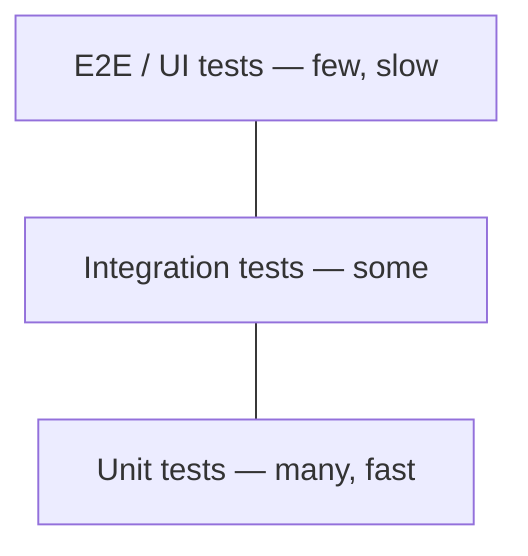

# Testing, Typing & Tooling

## Testing pyramid



## pytest essentials

```python
# app/pricing.py
def apply_discount(price: float, pct: float) -> float:
    if not 0 <= pct <= 100:
        raise ValueError("pct must be 0..100")
    return round(price * (1 - pct / 100), 2)
```

```python
# tests/test_pricing.py
import pytest
from app.pricing import apply_discount

def test_basic():
    assert apply_discount(100, 10) == 90

@pytest.mark.parametrize("price,pct,expected", [
    (100, 0, 100), (100, 100, 0), (59.99, 15, 50.99),
])
def test_param(price, pct, expected):
    assert apply_discount(price, pct) == expected

def test_invalid():
    with pytest.raises(ValueError, match="0..100"):
        apply_discount(100, 120)
```

### Fixtures (setup/teardown, dependency injection for tests)

```python
@pytest.fixture
def db():
    conn = create_test_db()     # setup
    yield conn                  # test runs here
    conn.close()                # teardown

@pytest.fixture(scope="session")
def client(): ...               # scopes: function, class, module, package, session

def test_user(db):
    db.insert(...)
```

`conftest.py` shares fixtures across a directory. Built-ins: `tmp_path`, `monkeypatch`, `capsys`, `caplog`.

### Mocking

Mock **where it is looked up**, not where it is defined.

```python
# app/service.py
import requests
def get_user(uid):
    r = requests.get(f"https://api/users/{uid}", timeout=5)
    r.raise_for_status()
    return r.json()["name"]
```

```python
from unittest.mock import patch, MagicMock
from app.service import get_user

@patch("app.service.requests.get")
def test_get_user(mock_get):
    mock_get.return_value = MagicMock(status_code=200, json=lambda: {"name": "Lenin"})
    assert get_user(1) == "Lenin"
    mock_get.assert_called_once_with("https://api/users/1", timeout=5)

def test_env(monkeypatch):
    monkeypatch.setenv("API_KEY", "test")
```

**Test doubles:** Dummy (unused filler), Stub (canned answers), Fake (working lightweight impl, e.g. in-memory repo), Mock (verifies interactions), Spy (records real calls).

### Testing async & FastAPI

```python
import pytest
@pytest.mark.asyncio            # pytest-asyncio
async def test_async():
    assert await some_coro() == 1

from fastapi.testclient import TestClient
from app.main import app
client = TestClient(app)
def test_health():
    assert client.get("/health").json() == {"status": "ok"}
```

### TDD cycle
**Red** (failing test) → **Green** (minimal code) → **Refactor**. Coverage: `pytest --cov=app` — aim for meaningful coverage of business logic, not a vanity 100%.

## Type hints

```python
from typing import Optional, Union, Any, Callable, TypeVar, Generic, Literal, TypedDict, Final
from collections.abc import Iterable, Iterator, Sequence, Mapping

def greet(name: str, times: int = 1) -> str: ...
def find(uid: int) -> User | None: ...              # 3.10+ union syntax
def process(items: Iterable[str]) -> list[str]: ...  # accept abstract, return concrete
Handler = Callable[[Request], Response]
Mode = Literal["r", "w"]
MAX: Final = 10

class UserDict(TypedDict):
    id: int
    name: str

T = TypeVar("T")
def first(xs: Sequence[T]) -> T: return xs[0]

class Stack(Generic[T]):                  # or 3.12+:  class Stack[T]:
    def __init__(self): self._items: list[T] = []
    def push(self, x: T) -> None: self._items.append(x)
    def pop(self) -> T: return self._items.pop()
```

- Hints are **not enforced at runtime** — use `mypy`/`pyright` in CI; Pydantic enforces at runtime.
- `Protocol` = structural typing (see OOP page).

## Logging (not print)

```python
import logging
logging.basicConfig(level=logging.INFO,
                    format="%(asctime)s %(levelname)s %(name)s %(message)s")
log = logging.getLogger(__name__)

log.info("order created", extra={"order_id": 42})
try:
    1 / 0
except ZeroDivisionError:
    log.exception("calculation failed")     # includes traceback
```

Levels: DEBUG < INFO < WARNING < ERROR < CRITICAL. In production use **structured (JSON) logs** + correlation/request IDs.

## Environment & packaging

| Tool | Purpose |
|---|---|
| `venv` / `uv` / `poetry` | isolated environments & dependency management |
| `pyproject.toml` | single config for build, deps, tools (PEP 518/621) |
| `pip-tools` / lock files | reproducible builds |
| `ruff` | lint + format (replaces flake8/isort/black) |
| `mypy` / `pyright` | static type checking |
| `pre-commit` | run checks before commits |

```toml
[project]
name = "orders-service"
version = "1.0.0"
requires-python = ">=3.11"
dependencies = ["fastapi>=0.110", "sqlalchemy>=2.0"]

[tool.ruff]
line-length = 100
```

## PEP 8 highlights

- `snake_case` functions/variables, `PascalCase` classes, `UPPER_CASE` constants.
- 4-space indentation; ≤ 79/99-char lines; two blank lines between top-level defs.
- Imports: stdlib → third-party → local, one per line.
- `if x is None`, not `== None`; `if not items`, not `len(items) == 0`.

!!! success "Say this in the interview"
    "Unit tests with pytest and fixtures for logic, integration tests against a real DB in Docker for repositories, and mocks only at system boundaries like HTTP calls. Type hints checked by mypy in CI, ruff for linting, and structured logging with request IDs."
